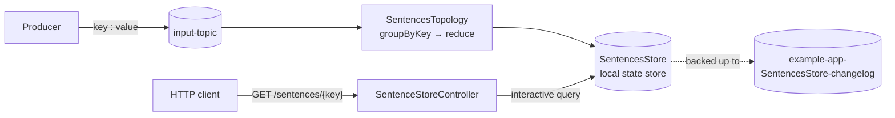

# Kafka Streams + Spring Boot Integration

A small Spring Boot application that runs a **Kafka Streams** topology inside the Spring context and exposes its **state store** over a REST endpoint using Kafka Streams **interactive queries**.

Each record that arrives on `input-topic` is grouped by its key, and its value is appended to everything seen before for that key. The running sentence for each key is kept in a local state store (`SentencesStore`), which you can read over HTTP.

```
input-topic                     SentencesStore               GET /sentences/user1
───────────                     ──────────────               ────────────────────
user1 : Hello        ──►        user1 → "Hello"
user1 : from         ──►        user1 → "Hello from"
user1 : Kafka        ──►        user1 → "Hello from Kafka"   ──►  Hello from Kafka
user2 : Hi           ──►        user2 → "Hi"
```

## Tech stack

| Component      | Version                         |
|----------------|---------------------------------|
| Java           | 21 (Gradle toolchain)           |
| Spring Boot    | 4.1.2                           |
| Spring Kafka   | managed by Spring Boot          |
| Kafka Streams  | managed by Spring Boot          |
| Gradle         | 9.8.2 (via the included wrapper)|

## How it works



### `KafkaStreamsConfig`

[`config/KafkaStreamsConfig.java`](src/main/java/io/github/kartikkumarmahindrakar/kafka/streams/spring/integration/config/KafkaStreamsConfig.java)

- `@EnableKafkaStreams` tells Spring Kafka to create a `StreamsBuilderFactoryBean`, which builds and manages the `KafkaStreams` lifecycle (start on context startup, close on shutdown).
- Defines the default `KafkaStreamsConfiguration` bean with:
  - `application.id` = `example-app` (also used as the consumer group id and as the prefix for internal topics)
  - `bootstrap.servers` = `localhost:9092`
  - record cache size = `0`, which turns off caching so every update to the store is forwarded downstream immediately (you see one "Reduced" log line per input record).
- Declares a `NewTopic` bean so Spring's `KafkaAdmin` creates `output-topic` (1 partition, 1 replica) at startup. The topology does not write to it yet.

### `SentencesTopology`

[`topology/SentencesTopology.java`](src/main/java/io/github/kartikkumarmahindrakar/kafka/streams/spring/integration/topology/SentencesTopology.java)

Spring injects the shared `StreamsBuilder` into the `@Autowired` method, which defines the processing:

1. `stream("input-topic")` reads records with `String` keys and values.
2. `peek(...)` logs each incoming record.
3. `groupByKey()` groups records by their existing key (no repartitioning needed).
4. `reduce((a, b) -> a + " " + b, Materialized.as("SentencesStore"))` joins values for the same key with a space and materializes the result in the `SentencesStore` key-value store.
5. `toStream().peek(...)` logs each updated result.

### `SentenceStoreController`

[`controller/SentenceStoreController.java`](src/main/java/io/github/kartikkumarmahindrakar/kafka/streams/spring/integration/controller/SentenceStoreController.java)

Gets the running `KafkaStreams` instance from the `StreamsBuilderFactoryBean`, opens a read-only view of `SentencesStore`, and returns the value for the requested key.

| Method | Path               | Response                                                    |
|--------|--------------------|-------------------------------------------------------------|
| `GET`  | `/sentences/{key}` | The concatenated sentence for `key`, or an empty body if the key has not been seen |

## Prerequisites

- **JDK 21**
- **A Kafka broker** on `localhost:9092`. The quickest way is Docker (below).

You don't need to install Gradle; use the included wrapper (`./gradlew` or `gradlew.bat`).

## Getting started

### 1. Start Kafka

Run a single-node Kafka broker in KRaft mode (no ZooKeeper) with the official image:

```bash
docker run -d --name kafka -p 9092:9092 apache/kafka:4.1.0
```

### 2. Create the input topic

The application does not create `input-topic` itself, so create it before starting the app:

```bash
docker exec -it kafka /opt/kafka/bin/kafka-topics.sh \
  --bootstrap-server localhost:9092 \
  --create --topic input-topic \
  --partitions 1 --replication-factor 1
```

### 3. Run the application

```bash
git clone https://github.com/KartikkumarMahindrakar/kafka-springboot-integration.git
cd kafka-springboot-integration

# macOS / Linux / Git Bash
./gradlew bootRun

# Windows (cmd / PowerShell)
gradlew.bat bootRun
```

The REST API starts on port `8080`.

### 4. Produce some records

Start a console producer that reads `key:value` lines:

```bash
docker exec -it kafka /opt/kafka/bin/kafka-console-producer.sh \
  --bootstrap-server localhost:9092 \
  --topic input-topic \
  --property parse.key=true \
  --property key.separator=:
```

Then type:

```
user1:Hello
user1:from
user1:Kafka
user2:Hi
```

The application logs each step:

```
Incoming record - Key: user1, Value: Hello
Reduced - Key: user1, Value:Hello
Incoming record - Key: user1, Value: from
Reduced - Key: user1, Value:Hello from
...
```

### 5. Query the state store

```bash
curl http://localhost:8080/sentences/user1
# Hello from Kafka

curl http://localhost:8080/sentences/user2
# Hi
```

## Configuration

The effective Kafka Streams settings come from the `KafkaStreamsConfiguration` bean in `KafkaStreamsConfig`. Because that bean replaces Spring Boot's auto-configured one, the `spring.kafka.streams.*` values in `application.yaml` are not used for Kafka Streams. To point the app at a different broker or change the application id, edit `KafkaStreamsConfig`.

| Setting                | Value            | Where                     |
|------------------------|------------------|---------------------------|
| `application.id`       | `example-app`    | `KafkaStreamsConfig`      |
| `bootstrap.servers`    | `localhost:9092` | `KafkaStreamsConfig`      |
| Record cache size      | `0` (disabled)   | `KafkaStreamsConfig`      |
| Spring application name| `spring.integration` | `application.properties` |
| HTTP port              | `8080` (default) | Spring Boot default       |

### Topics

| Topic                                   | Created by                  | Purpose                                   |
|-----------------------------------------|-----------------------------|-------------------------------------------|
| `input-topic`                           | You (step 2)                | Source of `key:value` records             |
| `example-app-SentencesStore-changelog`  | Kafka Streams, automatically| Backs up `SentencesStore` for fault tolerance |
| `output-topic`                          | `KafkaAdmin` at startup     | Declared but not yet used by the topology |

## Building and testing

```bash
./gradlew build      # compile, run tests, and package the jar
./gradlew test       # run tests only
```

The packaged jar is written to `build/libs/` and can be run with:

```bash
java -jar build/libs/spring.integration-0.0.1-SNAPSHOT.jar
```

The test suite has a single `@SpringBootTest` context-load test. It starts the whole application, including Kafka Streams, so have the broker running when you run it.

## Resetting state

Kafka Streams keeps the store on local disk (by default under `<java.io.tmpdir>/kafka-streams/example-app`) and in the changelog topic. To start from a clean slate, stop the app and run the reset tool:

```bash
docker exec -it kafka /opt/kafka/bin/kafka-streams-application-reset.sh \
  --bootstrap-server localhost:9092 \
  --application-id example-app \
  --input-topics input-topic
```

Then delete the local state directory before starting the app again.

## Project structure

```
.
├── build.gradle
├── settings.gradle
├── gradlew / gradlew.bat               # Gradle wrapper
└── src
    ├── main
    │   ├── java/io/github/kartikkumarmahindrakar/kafka/streams/spring/integration
    │   │   ├── Application.java                    # Spring Boot entry point
    │   │   ├── config/KafkaStreamsConfig.java      # Streams config + topic declaration
    │   │   ├── controller/SentenceStoreController.java  # REST endpoint for interactive queries
    │   │   └── topology/SentencesTopology.java     # Stream processing logic
    │   └── resources
    │       ├── application.properties
    │       └── application.yaml
    └── test/java/.../ApplicationTests.java         # Context-load test
```

## Troubleshooting

- **`InvalidStateStoreException` / HTTP 500 from `/sentences/{key}`**: the store can only be queried while Kafka Streams is in the `RUNNING` state. Right after startup or during a rebalance it may not be ready yet. Wait a few seconds and retry.
- **`MissingSourceTopicException` or the app never processes records**: `input-topic` doesn't exist. Create it as shown in step 2.
- **Connection errors to `localhost:9092`**: the broker isn't running or isn't reachable. Check `docker ps` and that port `9092` is mapped.
